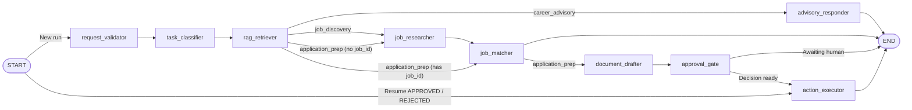

# JobMate AI

**Truth-grounded AI Career Co-Pilot & Placement Automation Platform.**

Built with a **FastAPI Modular Monolith** + **LangGraph Multi-Agent Orchestrator** + **React 19 Frontend**, enforcing verified-fact-only document generation, strict `user_id` data isolation, consent-gated Career Memory, and human approval before any external side effect.

---

## Core Architecture & Infrastructure

| Layer | Technology / Component | Role |
| :--- | :--- | :--- |
| **API & Backend** | FastAPI, Python 3.11, Async SQLAlchemy 2.0, Pydantic v2 | Modular domain services under `backend/app/modules/` |
| **Database** | PostgreSQL + Alembic | ACID source of truth (`UTC` timestamps, UUID PKs, migrations `0001`–`0010`) |
| **Cache & Queue** | Redis + Celery (`jobmate`) | Job search TTL caching, background tasks (`jobmate.reminders.dispatch_due`) |
| **Vector Store (RAG)** | ChromaDB HTTP v2 (with `InMemoryVectorStore` test/fallback) | User-isolated semantic retrieval across profile, facts & docs |
| **AI & Agents** | `LLM_MODE` switch (`claude` via Anthropic `claude-sonnet-5-5` or `openai` via `gpt-4o-mini` / `text-embedding-3-small`) + `web_search` + LangGraph | Live web job discovery, multi-turn tool calling, checkpointed workflows |
| **Auth & Calendar** | Google OAuth 2.0 / OIDC, PKCE, HS256 JWT Cookie, Google Calendar API v3 | Revocable sessions (`user_sessions`) + Fernet-encrypted Calendar tokens |
| **Frontend** | React 19, TypeScript, Vite, TanStack Query v5, Tailwind CSS v4 | Feature-modular SPA under `frontend/src/features/` |

---

## Multi-Agent Workflow (`LangGraph StateGraph`)

Defined in [`backend/app/agents/graph.py`](backend/app/agents/graph.py) with checkpointed pause/resume and bounded step/token budgets:



**9 Specialist Nodes (`backend/app/agents/nodes/`):**
- `request_validator` -> `task_classifier` -> `rag_retriever` (sanitized user-scoped ChromaDB chunks)
- `job_researcher` (live OpenAI `web_search`) -> `job_matcher` (weighted deterministic + semantic scoring) -> `document_drafter` (verified facts only + anti-hallucination gate)
- `approval_gate` (creates pending human confirmation) -> `action_executor` (runs approved side effects) | `advisory_responder` (grounded Q&A)

---

## Conversational Co-Pilot & OpenAI Tool Calling

[`CopilotChatService`](backend/app/modules/copilot/service.py) orchestrates persistent multi-turn sessions backed by **19 user-scoped tools** in [`backend/app/modules/copilot/toolkit.py`](backend/app/modules/copilot/toolkit.py):

| Domain | Tools Exposed to Co-Pilot |
| :--- | :--- |
| **Profile & Knowledge** | `get_profile_and_skills`, `update_career_profile`, `sync_career_knowledge`, `query_career_knowledge` |
| **Jobs & Documents** | `search_jobs`, `calculate_job_match`, `generate_tailored_document` |
| **Applications** | `list_applications`, `create_or_update_application`, `prepare_application_submission` *(gated)* |
| **Approvals & Calendar** | `list_pending_approvals`, `list_calendar_events` *(7-day window)*, `propose_calendar_event` *(gated)* |
| **Interviews & Gaps** | `list_interview_sessions`, `get_skill_gap_plan` |
| **Memory & Reminders** | `list_career_memory`, `save_career_memory` *(requires consent)*, `list_reminders`, `schedule_reminder` |

**Co-Pilot Turn Flow:**
1. Load approved `CareerMemory` into system context **only if** `user_profiles.ai_consent_given = true`.
2. Execute OpenAI function-calling loop against user-scoped repositories (`current_user.id`).
3. Route external actions (`submit_application`, `create_calendar_event`) through `ApprovalRequest` cards — never executed until explicitly approved.

---

## Core Modules

- **Auth & Account Lifecycle (`authentication`):** Google OAuth 2.0/OIDC login, incremental Calendar OAuth reuse, full personal JSON export (`GET /api/v1/auth/export`), and cascade account deletion (`DELETE /api/v1/auth/account`).
- **Resume & Profile (`profile`, `resume`):** PDF/DOCX magic-byte validation, PyMuPDF/`python-docx` extraction, fact verification workflow (`ResumeFact`), never fabricating unverified credentials.
- **Jobs, Matching & Docs (`jobs`, `matching`, `documents`):** Live OpenAI web search, explainable match scoring, versioned tailored resumes/cover letters, ATS PDF/DOCX/MD export.
- **Applications & Calendar (`applications`, `calendar`, `approvals`):** 8-state pipeline state machine, human approval center, strict 7-day Google Calendar view (`/calendar`).
- **Interviews & Memory/Reminders (`interviews`, `memory`, `reminders`):** Mock interviews with 4-criterion rubric grading (`technical_accuracy`, `communication_clarity`, `star_structure`, `role_alignment`), skill-gap roadmaps, consent-gated memory, timezone-aware `dedup_key` reminders with bounded retry backoff.

---

## Project Layout

```text
backend/
  app/
    agents/          # LangGraph StateGraph, nodes, policies, state & tool registry
    core/            # Config, logging redaction, JWT/PKCE/Fernet security, exceptions
    database/        # Async SQLAlchemy engine & Alembic migrations (0001 -> 0010)
    integrations/    # OpenAI (Chat/Tools/Embeddings/Web Search), ChromaDB, Google OAuth & Calendar
    modules/         # authentication, profile, resume, jobs, matching, documents,
                     # applications, rag, agents, approvals, calendar, copilot,
                     # interviews, memory, reminders
    workers/         # Celery app + periodic tasks
  scripts/           # seed_user_data.py (idempotent realistic workspace seeder)
  tests/             # Pytest unit & multi-agent integration suite
frontend/
  src/
    features/        # Domain UI pages & React Query hooks
    services/        # Typed fetch API client (30s timeout + transient GET retry)
  tests/             # Vitest + React Testing Library suite
docs/                # Architecture, DB schema, API reference, security controls
```

---

## Quick Start

### 1. Environment Configuration
```bash
cp .env.example .env
# Set DATABASE_URL, REDIS_URL, CHROMA_URL, LLM_MODE (claude|openai), ANTHROPIC_API_KEY / OPENAI_API_KEY, GOOGLE_CLIENT_ID, GOOGLE_CLIENT_SECRET, APP_SECRET_KEY
```

### 2. Backend Setup, Migrations & Seed
```bash
cd backend
python3.11 -m venv .venv
source .venv/bin/activate
pip install -r requirements.txt

alembic upgrade head
python -m scripts.seed_user_data --email your-email@example.com   # optional realistic seed
uvicorn app.main:app --reload --port 8000
```

*(Optional background worker for due reminders):*
```bash
cd backend && .venv/bin/celery -A app.workers.celery_app worker --loglevel=info
```

### 3. Frontend Setup
```bash
cd frontend
npm install
npm run dev   # http://localhost:5173 (proxies /api -> localhost:8000)
```

### 4. Verification Commands
```bash
# Backend tests, lint, strict types & security scan
cd backend
.venv/bin/pytest tests -v
.venv/bin/ruff check .
.venv/bin/mypy app scripts/seed_user_data.py
.venv/bin/bandit -r app -q

# Frontend tests, typecheck & build
cd frontend
npm test
npm run typecheck
npm run build
```

### 5. Standalone Docker Builds (Ports `33339` & `33340`)
Both Dockerfiles build directly from the **repository root** (and copy root `.env` when present):
```bash
# Backend container (port 33339; set RUN_MIGRATIONS=true to run Alembic on boot)
docker build -f backend/Dockerfile -t jobmate-backend .
docker run -d --name jobmate-backend -p 33339:33339 -e RUN_MIGRATIONS=true jobmate-backend

# Frontend Nginx container (port 33340; optional API_PROXY_URL proxies /api -> backend)
docker build -f frontend/Dockerfile -t jobmate-frontend .
docker run -d --name jobmate-frontend -p 33340:33340 -e API_PROXY_URL=http://host.docker.internal:33339 jobmate-frontend
```

**Production Domains:** Frontend `https://jobmate.techcreed.in` (`VITE_API_BASE_URL=https://jobmateapi.techcreed.in/api/v1`) and Backend `https://jobmateapi.techcreed.in` (`FRONTEND_URL`, `CORS_ALLOWED_ORIGINS`, `GOOGLE_REDIRECT_URI=https://jobmateapi.techcreed.in/api/v1/auth/google/callback`).

---

## Documentation
- [Architecture Overview](docs/architecture.md)
- [Database Schema](docs/database-schema.md)
- [API v1 Reference](docs/api-documentation.md)
- [Security Controls](docs/security.md)
